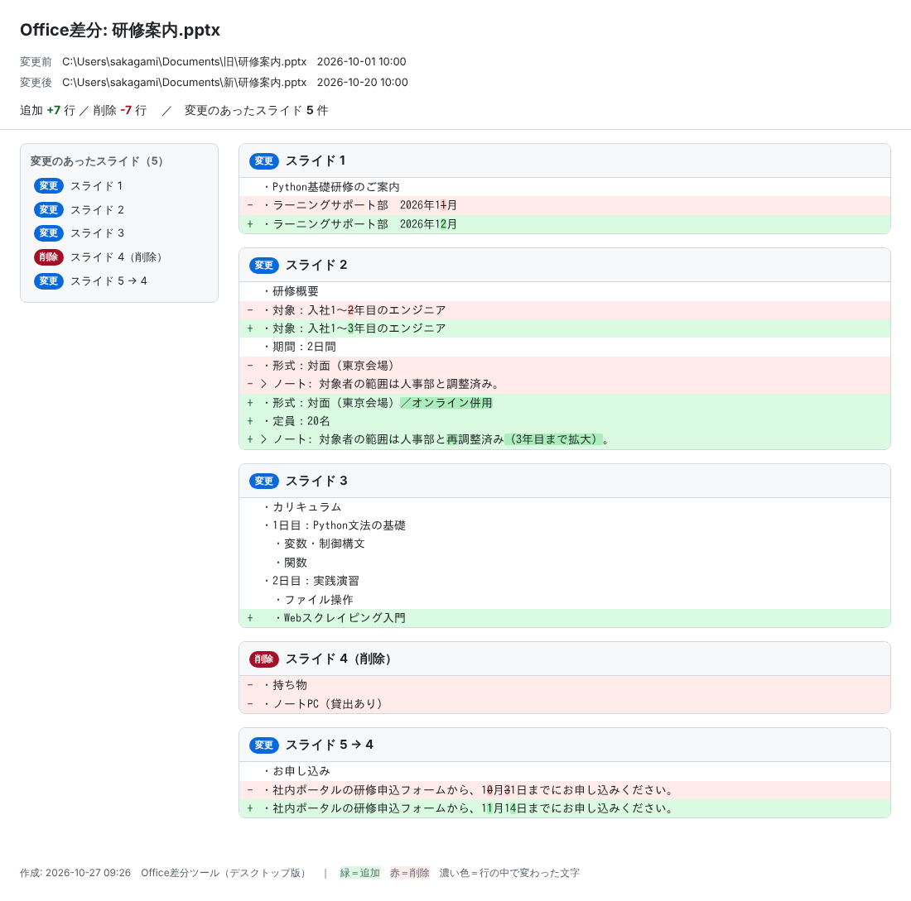
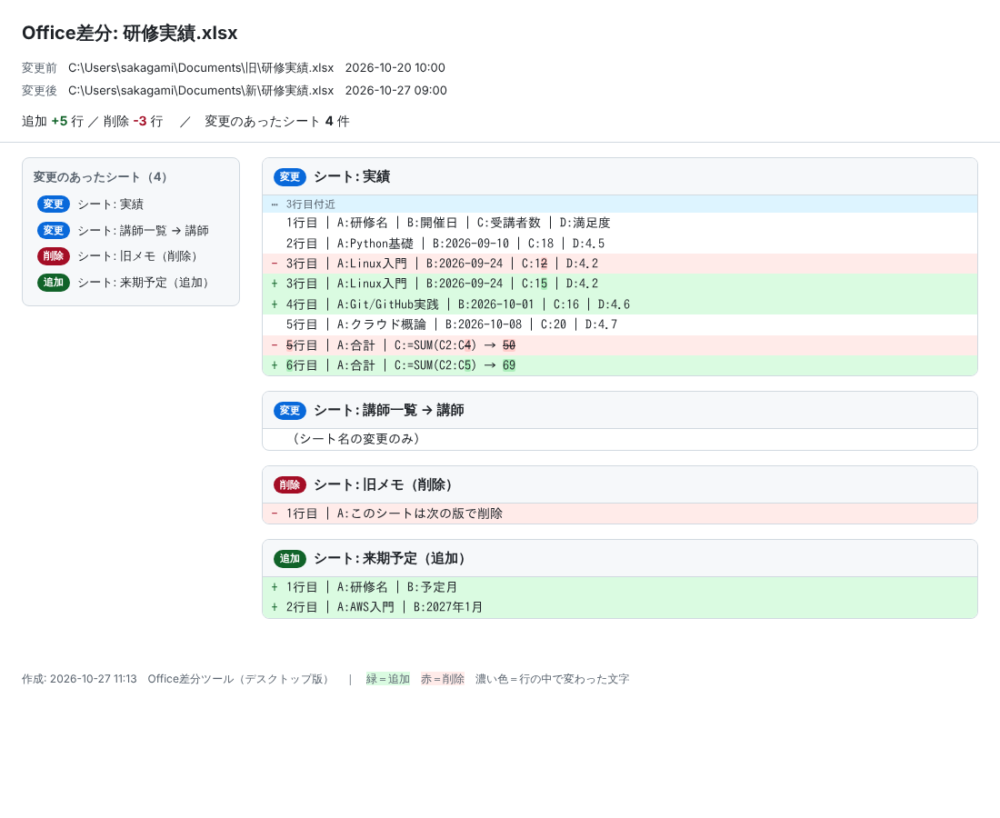

# Office差分ツール（デスクトップ版）

2つの Word（.docx）、PowerPoint（.pptx）、Excel（.xlsx / .xlsm）ファイルを比べて、変更点を **ブラウザで見られる HTML** と、テキストの .diff ファイル（unified diff 形式）に書き出します。
Office のインストールは不要です。Windows 10 / 11 標準の機能だけで動きます。

> 同じ内容をテキスト形式でまとめたものが [`使い方.txt`](使い方.txt) です（メモ帳でそのまま読めます）。

## ダウンロード

配布用の `OfficeDiff.zip` を管理者から受け取るか、このページ右上の **Code → Download ZIP** でダウンロードします。
（Download ZIP の場合はフォルダ名が `office-diff-desktop-main` になり、開発用の `tests` などのフォルダも入っていますが、使い方は同じです）

## 準備（最初の1回だけ）

1. ダウンロードした zip ファイルを右クリック →「プロパティ」→ 下の方の「**許可する**」にチェック → OK
   （これをしないと、実行時に警告が出ることがあります）
2. zip を展開し、`OfficeDiff` フォルダごと好きな場所に置きます（デスクトップなど）

| ファイル | 役割 |
|---|---|
| `OfficeDiff.bat` | ここにファイルをドロップする |
| `OfficeDiff_入れ替え.bat` | 変更前／変更後を逆にして比べたいときに使う |
| `OfficeDiff.ps1` | 本体。`.bat` と同じフォルダに置いたままにしてください |
| `README.md` | この説明書（VS Code や GitHub で見ると画像付きで表示されます） |
| `使い方.txt` | 同じ内容のテキスト版（メモ帳で読めます） |
| `images/` | README 用の画像 |
| `output/` | 比較結果の保存先（初回の実行で自動的に作られます） |

`.bat` と `.ps1` の3つは必ず同じフォルダに置いてください。

## 使い方

3通りの方法があり、どれでも同じ結果になります。

| 状況 | 操作 |
|---|---|
| **A.** 2つのファイルが同じフォルダにある | Ctrl キーを押しながら2つを選び、まとめて `OfficeDiff.bat` にドラッグ＆ドロップ |
| **B.** 別のフォルダにある（同じ名前のファイル同士など） | 1つ目のファイルだけを `OfficeDiff.bat` にドロップ → ファイル選択画面で、もう1つを選んで「開く」 |
| **C.** どこからでも | `OfficeDiff.bat` をダブルクリック → ファイル選択画面が2回開くので、1つずつ選ぶ |

黒い画面に結果が出て、差分の HTML がブラウザ（Edge など）で開きます。何かキーを押すと黒い画面が閉じます。

- 更新日時が**古い方を変更前**、**新しい方を変更後**として比べます
- 前後が逆になったときは、`OfficeDiff_入れ替え.bat` にドロップし直してください
- 結果は **`OfficeDiff` フォルダの中の `output` フォルダ**に、次の2つが保存されます（`output` が無ければ自動で作ります）
  - `<ファイル名>_差分_<日付-時刻>.html` … ブラウザ表示用。メールやチャットで渡せば、相手もブラウザだけで見られます
  - `<ファイル名>_差分_<日付-時刻>.diff` … テキスト版（VS Code などのエディタ用）

## 結果の見方



HTML では、左に変更のあったスライド（Word は見出しごとの変更箇所）の一覧が出て、クリックでその場所に移動できます。
**緑＝追加、赤＝削除**で、行の中で変わった文字だけが濃い色になります（「3営業日」→「5営業日」なら「3」「5」だけ）。

.diff ファイルの見方:

| 行頭 | 意味 |
|---|---|
| `-` | 変更前にあって、変更後で消えた行（削除） |
| `+` | 変更後に増えた行（追加） |
| 空白 | 変わっていない行（前後の文脈） |

PowerPoint はスライド単位で比べます。

| 表示 | 意味 |
|---|---|
| `## スライド 3` | 3枚目の中身が変わった |
| `## スライド 5 → 4` | 5枚目だったスライドが4枚目になり、中身も変わった |
| `-## スライド 4（削除）` | 4枚目のスライドが削除された |
| `+## スライド 2（追加）` | 2枚目にスライドが追加された |

内容が同じで番号だけ変わったスライドは表示しません。

Excel はシート単位・行単位で比べます。

| 表示 | 意味 |
|---|---|
| `## シート: 実績` | 「実績」シートの中身が変わった |
| `## シート: 講師一覧 → 講師` | シート名が変わった（中身が同じなら「シート名の変更のみ」） |
| `-## シート: 旧メモ（削除）` / `+## シート: 来期予定（追加）` | シートが削除された／追加された |
| `3行目 \| A:Linux入門 \| C:15` | 1行を「列:値」で表示。空のセルは省略 |
| `C:=SUM(C2:C5) → 69` | 数式と、その計算結果 |
| `⋯ 3行目付近` | 変更のあった場所（前後2行も表示） |

- 行を挿入・削除しても、それ以降の行がすべて「変更」にはならず、挿入・削除した行だけが出ます
- 日付は `2026-09-24` の形で表示します
- 数万行の大きなシートで変更が広い範囲にわたるときは、処理時間を抑えるため同じ行番号どうしで比べます



出力例:

```diff
Office差分: 研修案内.pptx
変更前: C:\Users\...\旧\研修案内.pptx  (2026-10-01 10:00)
変更後: C:\Users\...\新\研修案内.pptx  (2026-10-20 10:00)
作成: 2026-10-26 13:15  追加 +7 行 / 削除 -7 行

--- C:\Users\...\旧\研修案内.pptx	2026-10-01 10:00
+++ C:\Users\...\新\研修案内.pptx	2026-10-20 10:00
 ## スライド 2
 ・研修概要
-・対象：入社1〜2年目のエンジニア
+・対象：入社1〜3年目のエンジニア
 ・期間：2日間

-## スライド 4（削除）
-・持ち物
-・ノートPC（貸出あり）

 ## スライド 5 → 4
 ・お申し込み
-・社内ポータルの研修申込フォームから、10月31日までにお申し込みください。
+・社内ポータルの研修申込フォームから、11月14日までにお申し込みください。
```

.diff ファイルは VS Code や Notepad++ で開くと、追加行が緑・削除行が赤で色分けされます。

## 対象外

- 文字の色・フォント・配置など、書式だけの変更
- 画像そのものの変更（画像の名前は `[画像: 図 3]` のように表示されます）
- 旧形式の .doc / .ppt（Office で .docx / .pptx に保存し直せば使えます）
- パスワード付きのファイル
- Excel のグラフ・図形・コメント・条件付き書式、セルの色や罫線
- 旧形式の .xls（Excel で .xlsx に保存し直せば使えます）

## うまく動かないとき

| 症状 | 対処 |
|---|---|
| 黒い画面が一瞬で消える／何も起きない | 3つのファイルが同じフォルダにあるか確認してください |
| 「スクリプトの実行が無効」「デジタル署名されていません」と出る | 会社のPCの設定で PowerShell が制限されています。情報システム部門に相談してください |
| ファイル選択画面が見当たらない | 黒い画面やほかのウィンドウの後ろに隠れていることがあります。タスクバーを確認してください |

## 開発者向け

| パス | 内容 |
|---|---|
| `OfficeDiff.ps1` / `*.bat` | ツール本体（Windows PowerShell 5.1・標準機能のみ。Office 不要） |
| `tests/` | pytest（PowerShell 7 でも実行可）と、Windows で `.bat` 経由の動作を確かめる `check_bat_windows.ps1` |
| `scripts/make_zip.py` | 配布用 `OfficeDiff.zip` を作る（`python scripts/make_zip.py`） |
| `.github/workflows/test.yml` | push のたびに Windows PowerShell 5.1 と Linux（PowerShell 7）でテスト |

```bash
pip install -r requirements-dev.txt   # テスト用（サンプル資料の生成に python-docx / python-pptx を使う）
pytest -q
python scripts/make_zip.py            # → OfficeDiff.zip
```

テキスト化と差分のルール（スライドIDでの対応付けなど）は、GitHub の PR に差分をコメントする
[office-diff-sample](https://github.com/sakagami333/office-diff-sample) と同じです。
このリポジトリは、そこから 2026-10-27 に分離しました（それまでの変更履歴は office-diff-sample の `desktop/` を参照）。
